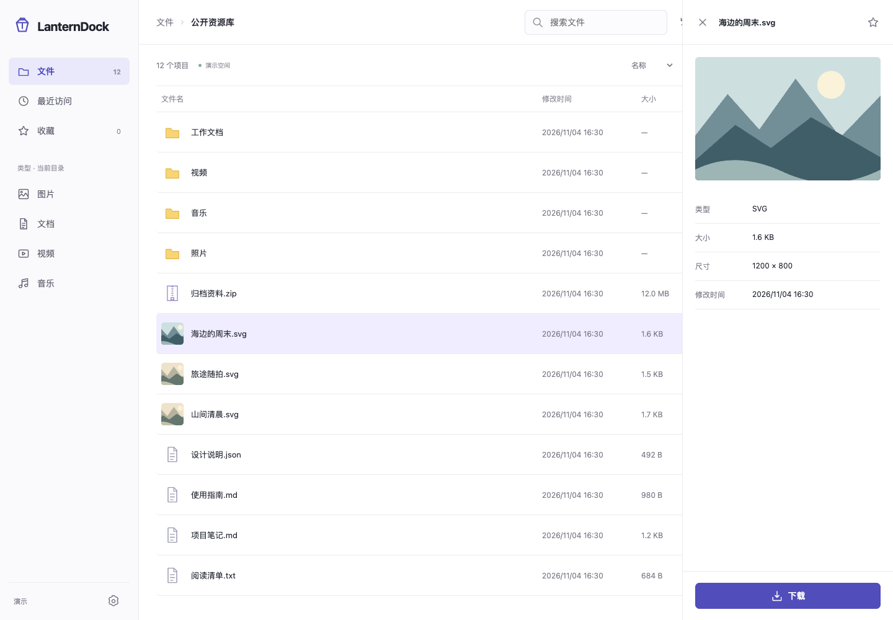
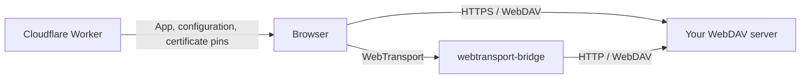

<div align="center">

# LanternDock

**A front door for your self-hosted files.**

Browse, preview, and download from your own WebDAV server — directly over HTTPS or WebTransport.

[](#project-status)
[](#quick-start)
[](https://preactjs.com/)
[](#deploy)

[Quick start](#quick-start) · [Configuration](docs/configuration.md) · [Development](docs/development.md) · [Report a bug](https://github.com/longern/lantern-dock/issues)

</div>



<details>
<summary>Mobile preview</summary>
<br>

</details>

_Screenshots show the built-in demo. The current interface is in Chinese._

## Why LanternDock?

Give visitors a simple interface to files you already host. LanternDock provides the browser UI and connection setup; your existing WebDAV service handles storage and permissions. Host the frontend on Cloudflare Workers and let visitors fetch files directly from the source.

## Features

- **Browse your files.** Directory navigation, search within the current directory, sorting, and list or grid views.
- **Preview before downloading.** Open images and text in a desktop side panel or a full-screen mobile preview.
- **Download with control.** Progress, cancellation, and streaming to disk when the browser supports a file picker.
- **Pick up where you left off.** Favorites and recent files stored in the visitor's browser.
- **Connect your way.** HTTPS / WebDAV, or WebDAV through [webtransport-bridge](https://github.com/longern/webtransport-bridge).
- **Keep credentials separate.** Backend Basic or Bearer authentication, plus an optional bridge token. Credentials stay in page memory.
- **Try it without a server.** A built-in demo with sample files.

## Quick start

Requires **Node.js 22.12+** and npm.

```sh
git clone https://github.com/longern/lantern-dock.git
cd lantern-dock
npm ci
npm run dev
```

Open [http://127.0.0.1:8787](http://127.0.0.1:8787). With no backend configured, the app starts in demo mode.

### Connect a WebDAV server

Copy the example configuration, then edit `.dev.vars` before starting the server:

```sh
cp .dev.vars.example .dev.vars
```

```dotenv
BACKEND_NAME="My files"
BACKEND_TRANSPORT="http"
BACKEND_ENDPOINT="https://files.example.com"
BACKEND_ROOT="/dav/public/"
BACKEND_AUTH="none"
```

Run `npm run dev` again. For a protected backend, set `BACKEND_AUTH` to `basic` or `bearer` and enter credentials in the connection dialog.

The backend needs WebDAV `PROPFIND` with `Depth: 1`, plus `GET` and `HEAD`. Direct HTTPS connections also need CORS configured for the frontend origin. Put the server origin in `BACKEND_ENDPOINT` and the WebDAV mount path in `BACKEND_ROOT`.

See the [configuration guide](docs/configuration.md) for CORS, WebTransport, authentication, and certificate updates.

## How it works



The Worker serves the frontend and `/api/config`. File contents travel directly between the browser and the configured backend or bridge.

Both connection modes use WebDAV for file access. The bridge carries one HTTP/1.1 exchange per WebTransport bidirectional stream using a project-specific mapping. WebTransport requires a compatible browser, a secure frontend context, and a reachable UDP endpoint; there is no automatic HTTPS fallback.

## Deploy

1. Set the real backend in [`wrangler.jsonc`](wrangler.jsonc).
2. Authenticate and deploy:

   ```sh
   npx wrangler login
   npm run deploy
   ```

3. Allow the deployed frontend origin in the backend's CORS policy or the bridge's origin policy.

The deploy command builds the Preact frontend into `dist/` and uploads it with the Worker. Local `.dev.vars` settings do not configure production. Pinned WebTransport also requires Workers KV and a private certificate webhook; follow the [deployment and certificate setup](docs/configuration.md#certificate-updates).

## Project status

LanternDock is in early development. The current version is a **read-only WebDAV browser**. Uploads, delete/rename operations, share management, identity adapters, and task execution are future work.

| Area           | Current behavior                                                                                                                                |
| -------------- | ----------------------------------------------------------------------------------------------------------------------------------------------- |
| Previews       | Images up to 25 MiB; text up to 1 MiB. Video, audio, PDF, and archive previews are not available yet.                                           |
| Downloads      | Stream to disk when supported; otherwise buffer in memory with a 256 MiB limit.                                                                 |
| Directories    | Directory responses are limited to 8 MiB. Search and type filters apply to the current directory.                                               |
| Image listings | Real backend files use generic icons; images load when opened for preview.                                                                      |
| Local records  | Favorites and recent paths live in local storage; credentials live only in page memory.                                                         |
| Validation     | Chromium desktop and mobile viewports, plus local real-bridge integration tests. Physical devices and individual backends need further testing. |

`BACKEND_ROOT` controls navigation. Enforce permissions and path restrictions on the backend or bridge.

## Roadmap

- [ ] Integrate existing backend identities.
- [ ] Add expiring, revocable guest grants with explicit scopes and quotas.
- [ ] Support scoped guest uploads and upload-only entry points.
- [ ] Expose predefined, authorized tasks such as media conversion.
- [ ] Improve backend thumbnails and preview coverage.

These features require backend enforcement as well as interface work. Track proposals and discuss priorities in [Issues](https://github.com/longern/lantern-dock/issues).

## Contributing

Bug reports, documentation improvements, and pull requests are welcome. For a bug report, include your browser version, connection mode, reproduction steps, and relevant errors. Remove credentials and private webhook URLs from logs before sharing them.

For larger changes, open an issue first to discuss the approach. To check code changes locally:

```sh
npm run check
npm test
```

See the [development guide](docs/development.md) for the project layout, browser tests, and integration tests against a real bridge.
