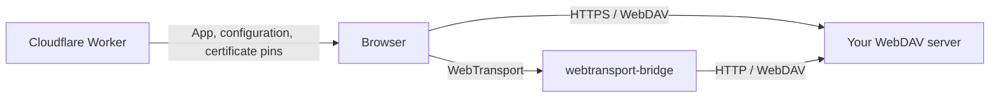

<div align="center">

# LanternDock

**A front door for your self-hosted files.**

Browse, preview, and download from your own WebDAV server — directly over HTTPS or WebTransport.

[](#project-status)
[](#quick-start)
[](https://preactjs.com/)
[](#deploy)
[](https://github.com/longern/lantern-dock/pkgs/container/lantern-dock)

[Quick start](#quick-start) · [Configuration](docs/configuration.md) · [Development](docs/development.md) · [Report a bug](https://github.com/longern/lantern-dock/issues)

</div>


<details>
<summary>Mobile preview</summary>
<br>

</details>

_Screenshots show the built-in demo in Chinese. The interface follows the browser language, with Chinese and English translations._

## Why LanternDock?

Give visitors a simple interface to files you already host. LanternDock provides the browser UI and connection setup; your existing WebDAV service handles storage and permissions. Host the frontend on Cloudflare Workers and let visitors fetch files directly from the source.

## Features

- **Browse your files.** Directory navigation, search within the current directory, sorting, and list or grid views.
- **Preview before downloading.** Open images, text and supported videos in a desktop side panel or a full-screen mobile preview.
- **Load smaller images.** The NAS service provides IIIF 3 thumbnails and resized previews, with bounded caches and ETag validation.
- **Download with control.** Progress, cancellation, and streaming to disk when the browser supports a file picker.
- **Pick up where you left off.** Favorites and recent files stored in the visitor's browser.
- **Connect your way.** HTTPS / WebDAV, or WebDAV through [webtransport-bridge](https://github.com/longern/webtransport-bridge).
- **Keep credentials separate.** Backend Basic or Bearer authentication, plus an optional bridge token. Credentials stay in page memory.
- **Set up with guidance.** A first-run wizard generates local or Cloudflare configuration, with an explicit demo option.
- **Host a public NAS folder.** The optional Go server provides anonymous, read-only WebDAV while keeping private state separate.
- **Receive files without accounts.** Expiring, revocable upload links enforce file-size, capacity and file-count limits on the NAS.
- **Use your existing SSO.** A shared OIDC/CIMD session displays a copyable site subject without blocking public browsing; the NAS verifies permissions separately.
- **Manage file drops in the browser.** Verified administrators can create and revoke collection links, inspect their quotas, and download completed private uploads from the management page.

## Quick start

Requires **Node.js 22.12+** and npm.

```sh
git clone https://github.com/longern/lantern-dock.git
cd lantern-dock
npm ci
npm run init
npm run dev
```

Open [http://127.0.0.1:8787](http://127.0.0.1:8787). With no backend configured, a setup wizard guides you through the connection options, generates configuration, and lets you recheck after applying it. Choose **先体验演示** to explore sample files without configuring a server. This temporary demo choice is not saved; `DEMO_MODE="true"` enables a site-wide demo.

### Connect a WebDAV server

Edit the `.env` created by `npm run init`, keeping its generated `SECRET_KEY`. Add your connection URL before restarting the server:

```dotenv
WEBDAV_URL="https://files.example.com/dav/public/"
```

Run `npm run dev` again. LanternDock derives the server origin and root directory from the URL. The default name, authentication choice, and other settings can stay unset. For a protected backend, optionally set `BACKEND_AUTH="basic"` or `"bearer"` to preselect the login method; visitors enter credentials in the connection dialog.

The backend needs WebDAV `PROPFIND` with `Depth: 1`, plus `GET` and `HEAD`. Direct HTTPS connections also need CORS configured for the frontend origin.

For a bridge, use `WEBTRANSPORT_URL` instead of `WEBDAV_URL`. They are mutually exclusive; no separate transport variable is needed. See the [configuration guide](docs/configuration.md) for WebTransport, optional settings, CORS, and certificate updates.

### Use the included NAS backend

The optional [`server/`](server/) backend combines public read-only WebDAV with private file drops. The NAS issues upload permissions and enforces quotas in SQLite; uploaded files stay in its private inbox until you choose to publish them. Visitors need only their collection link, with no account registration.

Use [`compose.nas.yaml`](compose.nas.yaml) for the NAS backend plus WebTransport bridge. It pulls `ghcr.io/longern/lantern-dock:latest` for amd64 or arm64; no NAS-side build is needed. See the [NAS deployment guide](docs/nas-server.md) for folder mounts, image updates, frontend configuration, browser management, and optional CLI commands to create and revoke collection links.

NAS containers support optional `PUID/PGID` (default `1000:1000`) to match a local NAS account. Startup prepares private database/inbox permissions, then runs the service and CLI as that non-root user. Public-folder ownership and permissions stay under NAS administration; give the selected account read access and keep the mount read-only. Docker's native non-root `user:` takes precedence over the environment defaults.

### Sign in with workers-sso

Set `SITE_ORIGIN` on the NAS and `OIDC_ISSUER_URL` **only on the Worker**; the Worker detects its HTTPS origin automatically. Open **我的账户**, sign in, and copy your 25-character **site** `sub` into the NAS `ADMIN_SUBJECTS` value (separate multiple site subjects with commas). The Worker maps third-party logins to stable site identities and signs short-lived, browser-bound credentials. The NAS discovers the Worker's public keys, verifies tokens locally and determines the role; it has no SSO configuration. See [authentication setup](docs/authentication.md) for deployment and key rotation, or the [identity protocol](docs/identity-protocol.md) for Discovery, JWT and DPoP details. workers-sso requires no changes.

### Manage file drops

After configuring `ADMIN_SUBJECTS` and rechecking the account, open **Administration** from **Me** on mobile or **My account** on desktop. Both the Worker and NAS must support the management scopes; update them together before using this page. A signed-in ordinary user does not receive administrator permissions.

- Create a collection with a title, expiry, per-file size limit, total capacity and file-count limit. Copy its upload link while the creation dialog is open: the secret is shown only once and cannot be recovered from the list.
- Review collection status and quota usage, or revoke a link to stop further uploads. Revoking or expiring a link does not delete completed files.
- Open **Private inbox** to list completed uploads, optionally filter by collection, and download them. Files remain private and are not published into WebDAV.

Recipients need only the upload link, not an account. Treat the full link as a password: anyone holding it can upload within its limits. This phase does not assign personal spaces, grant permissions to named users, or add resumable uploads. The NAS CLI remains available for local administration.

The included NAS uses `/dav/` for files and `/api` for inbox, account, management and capability metadata. Configure one backend address; individual feature paths need no environment variables. See the [service path contract](docs/backend-protocol.md).

## How it works



The Worker serves the frontend, `/api/config` and identity endpoints. It issues short-lived, browser-bound grants; the NAS enforces local roles and the required scope on each management request. File contents, including private inbox downloads, travel directly between the browser and the configured backend or bridge.

Both connection modes use WebDAV for file access. The bridge carries one HTTP/1.1 exchange per WebTransport bidirectional stream using a project-specific mapping. WebTransport requires a compatible browser, a secure frontend context, and a reachable UDP endpoint; there is no automatic HTTPS fallback.

## Deploy

1. Authenticate and deploy:

   ```sh
   npx wrangler login
   npm run deploy
   ```

2. Open the deployed site and complete the setup wizard. Copy its `.env` into the Cloudflare dashboard's variables import, **manually mark `SECRET_KEY` as Secret**, then deploy the variable changes and recheck.
3. Allow the deployed frontend origin in the backend's CORS policy or the bridge's origin policy.

The deploy command builds the Preact frontend into `dist/` and uploads it with the Worker. The wizard generates a key for a new deployment and preserves existing keys. Dashboard variables survive later Wrangler deployments; you can also configure public variables in [`wrangler.jsonc`](wrangler.jsonc). Local `.env` settings are not automatically uploaded. The deployment configuration automatically provisions or reuses the `KV` binding. Pinned WebTransport also needs a private certificate webhook; follow the [deployment and certificate setup](docs/configuration.md#certificate-updates).

## Project status

LanternDock is in early development. Public browsing is **read-only WebDAV**. The optional NAS backend adds **private uploads through scoped collection links** and **OIDC identity/administrator recognition**, with **web-based collection and private-inbox management** for verified administrators. The CLI remains available. Personal spaces and named-user grants, general file editing, public share management, resumable uploads, and task execution remain future work.

| Area           | Current behavior                                                                                                                                                                                                                          |
| -------------- | ----------------------------------------------------------------------------------------------------------------------------------------------------------------------------------------------------------------------------------------- |
| Previews       | NAS JPG previews up to 1600 px; original-image fallback up to 25 MiB; text up to 1 MiB. Supported videos play through native HTTPS or MP4Box + MediaSource over WebTransport. Audio-only, PDF and archive previews are not available yet. |
| Downloads      | Stream to disk when supported; otherwise buffer in memory with a 256 MiB limit.                                                                                                                                                           |
| Directories    | Directory responses are limited to 8 MiB, with a bounded 15-second NAS listing cache. Search and type filters apply to the current directory.                                                                                             |
| Image listings | NAS images and videos use lazy IIIF thumbnails; third-party DAV backends retain file-type icons. See [images and caching](docs/images.md) and [video playback](docs/video.md).                                                            |
| Local records  | Favorites and recent paths use local storage. Backend credentials and NAS grants stay in memory; login uses an HttpOnly cookie and a non-extractable browser key in IndexedDB.                                                            |
| File drops     | NAS-issued links with expiry, revocation, per-file and total byte limits, and file-count quotas. Files upload sequentially with progress and cancellation; incomplete files must be sent again.                                           |
| Validation     | Chromium desktop and mobile viewports, plus local real-bridge integration tests. Physical devices and individual backends need further testing.                                                                                           |

`BACKEND_ROOT` controls navigation. Enforce permissions and path restrictions on the backend or bridge.

## Roadmap

- [x] Add OIDC/CIMD login and NAS-enforced administrator identities.
- [x] Add expiring, revocable guest upload grants with explicit scopes and quotas.
- [x] Support scoped guest uploads and upload-only entry points.
- [x] Add a web interface for collection links and private inbox downloads.
- [ ] Support resumable uploads.
- [ ] Add named-user permissions and isolated personal spaces.
- [ ] Expose predefined, authorized tasks such as media conversion.
- [x] Add IIIF image thumbnails, resized previews and bounded caches.
- [x] Add video posters, native HTTPS playback and page-local WebTransport MP4 playback.
- [x] Identify Apple Live Photos and Android Motion Photos on the NAS; play on hold in the album. See [supported formats](docs/live-photos.md).

These features require backend enforcement as well as interface work. Track proposals and discuss priorities in [Issues](https://github.com/longern/lantern-dock/issues).

## Contributing

Bug reports, documentation improvements, and pull requests are welcome. For a bug report, include your browser version, connection mode, reproduction steps, and relevant errors. Remove credentials and private webhook URLs from logs before sharing them.

For larger changes, open an issue first to discuss the approach. To check code changes locally:

```sh
npm run check
npm test
```

See the [development guide](docs/development.md) for the project layout, browser tests, and integration tests against a real bridge.
