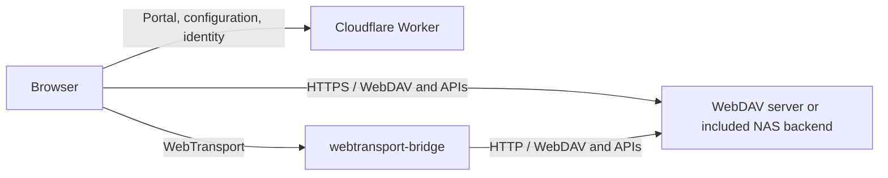

<div align="center">

# LanternDock

**A web front door for your self-hosted files.**

Browse your WebDAV library, preview photos and videos, and collect private uploads.\
Keep your files on your own server, with transfers going directly to the source.

[](https://github.com/longern/lantern-dock/actions/workflows/check.yml)
[](https://github.com/longern/lantern-dock/actions/workflows/nas.yml)
[](https://github.com/longern/lantern-dock/pkgs/container/lantern-dock)
[](#project-status)

[Quick start](#quick-start) · [Deployment](#deployment) · [Documentation](#documentation) · [Contributing](#contributing)

</div>


<details>
<summary>View the mobile interface</summary>
<br>

</details>

_Screenshots use the built-in demo. The interface supports English and Simplified Chinese and follows the browser language._

## Overview

LanternDock turns an existing WebDAV server into a file portal for desktop, tablet and mobile. Deploy the frontend on Cloudflare Workers and connect it to your storage over HTTPS or through [webtransport-bridge](https://github.com/longern/webtransport-bridge).

Use any compatible WebDAV server for browsing. Add the included Go backend when you need a public read-only library, indexed media albums, private file collection or member upload permissions. File contents travel between the browser and your backend; the Worker serves the portal, connection metadata and optional identity endpoints.

## Features

| Capability                   | What you can do                                                                                                                                                                                 |
| ---------------------------- | ----------------------------------------------------------------------------------------------------------------------------------------------------------------------------------------------- |
| **File browsing**            | Navigate directories, search and filter the current folder, sort files, and switch between list and grid views. Share direct links to folders and previews.                                     |
| **Photos and video**         | Browse albums, load thumbnails on demand, preview images and text, and play supported videos. The included backend adds indexed recursive albums, IIIF previews, Live Photos and Motion Photos. |
| **Transfers**                | Download with progress and cancellation, stream to disk where supported, and upload multiple files with a queue, per-file cancellation and the option to add more files.                        |
| **Private collection**       | Create expiring invitation links with size, capacity and file-count limits. Copy, share or show a QR code, and retrieve eligible active links again from administration.                        |
| **Accounts and permissions** | Sign in through OIDC/CIMD. Administrators manage invitations, private inboxes and direct upload permissions for members, including daily file-count and per-file limits.                        |
| **Personal preferences**     | Keep favorites and recent files in the visitor's browser. Use the same responsive interface in English or Simplified Chinese.                                                                   |

Collection, identity-backed upload permissions and indexed media features require the included backend. A third-party WebDAV server retains ordinary file browsing and current-folder albums. See [compatibility and limits](#compatibility-and-limits) for the current boundaries.

## Quick start

Requires **Node.js 22.12+** and npm.

```sh
git clone https://github.com/longern/lantern-dock.git
cd lantern-dock
npm ci
npm run init
npm run dev
```

Open [http://127.0.0.1:8787](http://127.0.0.1:8787). The setup wizard guides you through the connection settings. Choose its demo option to explore sample files before configuring storage.

To connect an existing WebDAV server, add its full URL to the generated `.env`, keeping the existing `SECRET_KEY`, then restart the development server:

```dotenv
WEBDAV_URL="https://files.example.com/dav/public/"
```

The backend must support `PROPFIND` with `Depth: 1`, `GET` and `HEAD`, with CORS allowing the frontend origin. Protected backends can use Basic or Bearer authentication; visitors enter their credentials in the connection dialog.

For a bridge connection, set `WEBTRANSPORT_URL` instead. Configure exactly one of these two URLs. The wizard can generate the configuration for either mode; see the [configuration guide](docs/configuration.md) for authentication, CORS and certificate setup.

## Deployment

The frontend and storage backend are deployed separately. Choose the storage option that fits your setup:

| Storage option             | Requirements                                                                                                              | Guide                                             |
| -------------------------- | ------------------------------------------------------------------------------------------------------------------------- | ------------------------------------------------- |
| **Existing WebDAV server** | An HTTPS WebDAV endpoint with CORS, or a compatible WebTransport bridge.                                                  | [Connection configuration](docs/configuration.md) |
| **Included NAS backend**   | Docker Compose, a public folder and persistent private storage. Published images support `linux/amd64` and `linux/arm64`. | [NAS deployment](docs/nas-server.md)              |

### Deploy the frontend

From the installed repository:

```sh
npx wrangler login
npm run deploy
```

Open the deployed site and complete the setup wizard. Import its generated variables into the Cloudflare dashboard, mark **`SECRET_KEY` as a Secret**, and deploy the variable changes. Allow the deployed frontend origin on the backend or bridge, then recheck the connection.

`npm run deploy` builds the frontend and deploys it with the Worker. Local `.env` values are not uploaded automatically. The supplied Wrangler configuration provisions or reuses the `KV` binding for certificate metadata and preserves dashboard variables on subsequent deployments.

For WebTransport, follow the [certificate update setup](docs/configuration.md#certificate-updates) so the bridge can publish its current certificate hashes.

### Run the included backend

The supplied [`compose.nas.yaml`](compose.nas.yaml) runs the NAS service and WebTransport bridge. Configure the public folder, site origin, certificate webhook and persistent NAS `SECRET_KEY` using the [NAS guide](docs/nas-server.md), then start the services:

```sh
docker compose -f compose.nas.yaml pull
docker compose -f compose.nas.yaml up -d
```

The public folder is mounted read-only. Uploads, quotas, the database and media caches live in a separate private data volume. The container supports `PUID` and `PGID` for matching your NAS account and runs the application as a non-root user.

The default image is `ghcr.io/longern/lantern-dock:latest`; set `NAS_IMAGE` to pin a published version, commit tag or digest. Keep the private volumes and NAS `SECRET_KEY` when updating. Frontend-only and documentation-only commits do not rebuild or publish the NAS image.

### Enable sign-in and administration

1. Set `OIDC_ISSUER_URL` on the **Worker**. The project integrates with [workers-sso](https://github.com/longern/workers-sso); a CIMD-capable provider needs no client registration or client secret.
2. Set `SITE_ORIGIN` on the **NAS** to the deployed frontend's HTTPS origin.
3. Sign in, copy your **site subject** from **My account**, and add it to the NAS `ADMIN_SUBJECTS` setting. Apply the environment change and recheck your account.
4. Open **Administration** from **Me** on compact layouts or **My account** on desktop.

Signing in identifies a member; the NAS decides their permissions. Administrators can grant direct uploads from **Users**, with deposits kept in the granting administrator's private inbox. See [authentication setup](docs/authentication.md) and [direct upload permissions](docs/nas-server.md#direct-upload-permissions).

## Collect files

1. Choose **Invite others to upload** from Files, or create an invitation in Administration.
2. Keep the defaults or adjust the note, expiry and upload limits, then create the link.
3. Copy the link, use system sharing where available, or display its QR code. Recipients can upload without creating an account.
4. Review received files and quota usage in Administration. Download from the private inbox, or revoke the invitation to stop further uploads.

Collected files stay private until you choose to publish them. Revoking or expiring an invitation preserves completed files. Eligible active invitations can be shared again without resetting their expiry, quotas or received files; older hash-only invitations require the original saved link.

## Architecture



- **Frontend:** Preact and Vite, with a single SPA entry. Public pages load directly; administration and its dedicated styles load on demand.
- **Worker:** Serves assets and public connection metadata, handles optional OIDC login, and issues short-lived, browser-bound NAS grants.
- **Backend:** Owns storage and authorization. The included Go service provides read-only WebDAV, a media index, private uploads and SQLite-backed quotas.
- **Bridge:** Optional transport for reaching the backend over WebTransport. Both connection modes use the same WebDAV and API contracts.

Backend Basic/Bearer credentials and NAS grants stay in page memory. Site login uses an encrypted HttpOnly cookie and a non-extractable browser proof key. Collection links are bearer permissions: anyone holding a full link can upload within its limits. The NAS encrypts recoverable invitation credentials using its persistent `SECRET_KEY`; the NAS and Worker may use independent values under the same variable name.

Permissions and path restrictions are enforced by the backend. Frontend navigation settings do not replace access control. See the [identity protocol](docs/identity-protocol.md) and [backend contract](docs/backend-protocol.md) for the trust model and service boundaries.

## Compatibility and limits

| Area                  | Current behavior                                                                                                                                                                                                                                          |
| --------------------- | --------------------------------------------------------------------------------------------------------------------------------------------------------------------------------------------------------------------------------------------------------- |
| **WebTransport**      | Requires a compatible browser, a secure frontend context and a reachable UDP endpoint. There is no automatic HTTPS fallback.                                                                                                                              |
| **Media previews**    | Images, text and browser-supported video. Codec support depends on the browser; playback does not transcode video. PDF, archive and audio-only previews are not implemented.                                                                              |
| **Downloads**         | Stream to disk where browser file pickers are supported. The memory-buffered fallback has a 256 MiB limit.                                                                                                                                                |
| **Uploads**           | Keep the page in the foreground; locking the device or switching apps can interrupt transfers. Guest links support resuming with the original file in the same tab on compatible NAS versions. Authenticated uploads currently restart interrupted files. |
| **Search and albums** | File search is local to the current directory. Recursive albums require backend SEARCH support; the included NAS maintains the index.                                                                                                                     |
| **Validation**        | Automated tests cover Chromium desktop, tablet and mobile viewports, with local real-bridge integration tests. Physical devices and individual third-party backends need separate validation.                                                             |

See [image delivery](docs/images.md), [video playback](docs/video.md) and [Live Photos](docs/live-photos.md) for format support and resource limits.

## Documentation

| Topic                    | Guide                                                                                                                         |
| ------------------------ | ----------------------------------------------------------------------------------------------------------------------------- |
| Deploy and connect       | [Configuration, CORS and certificates](docs/configuration.md) · [NAS server and Docker Compose](docs/nas-server.md)           |
| Accounts and permissions | [Authentication setup](docs/authentication.md) · [Identity protocol](docs/identity-protocol.md)                               |
| Media                    | [Images and caching](docs/images.md) · [Video playback](docs/video.md) · [Live Photos and Motion Photos](docs/live-photos.md) |
| Navigation and interface | [Page URLs](docs/routing.md) · [UI conventions](docs/ui.md) · [Translations](docs/i18n.md)                                    |
| Protocols                | [Backend API contract](docs/backend-protocol.md) · [Bridge protocol](docs/bridge-protocol.md)                                 |
| Development              | [Project layout, checks and integration tests](docs/development.md)                                                           |

## Project status

LanternDock is **experimental and under active development**. Public browsing, private collection links, member upload permissions, media previews and browser administration are implemented. Storage APIs and deployment settings may evolve; review changes before updating a deployment.

Current follow-up areas include resumable authenticated uploads, isolated personal spaces and predefined authorized tasks. Proposals and priorities are discussed in [Issues](https://github.com/longern/lantern-dock/issues).

## Contributing

Bug reports, documentation improvements and pull requests are welcome. For larger changes, open an issue first to discuss the approach.

For bug reports, include your browser and version, connection mode, relevant frontend/backend versions, reproduction steps and errors. Remove credentials, collection tokens and private webhook URLs from anything you share.

Run the relevant checks before submitting code:

```sh
npm run format:check
npm run check
npm test
```

UI changes should also run the browser tests; transport changes should run the real-bridge integration tests. The Go backend requires **Go 1.26+** for source development. See the [development guide](docs/development.md) for commands and prerequisites.

## License

LanternDock is licensed under the [MIT License](LICENSE).
