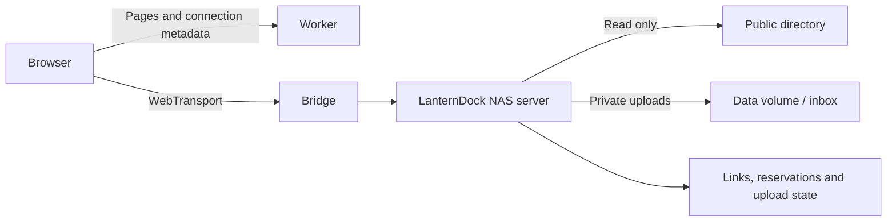

# NAS server and temporary file drops

LanternDock includes an optional Go backend in `server/`. It serves a public folder as **anonymous, read-only WebDAV** and accepts private uploads through **expiring, revocable file-drop links**. Visitors do not need accounts. You can continue using another WebDAV backend for browsing; file-drop links require this NAS service.

The NAS issues the links, enforces quotas and stores upload state in SQLite. The Worker serves the UI, public connection metadata and certificate hashes. File bytes go directly to the NAS over HTTPS or through `webtransport-bridge`; they never pass through the Worker.



## Deploy on a NAS with Docker Compose

The NAS backend image is **`ghcr.io/longern/lantern-dock:latest`**, with `linux/amd64` and `linux/arm64` variants. The included [`compose.nas.yaml`](../compose.nas.yaml) pulls it alongside the bridge image; your NAS does not need Go or a local build. Clone the repository or copy the Compose file onto your NAS. Set these values in a local `.env` beside it, preserving other existing settings:

```dotenv
PUBLIC_DIR="/replace/with/the/actual/public/folder"
SITE_ORIGIN="https://nas.example.com"
CERT_WEBHOOK_URL="https://nas.example.com/api/certificates/your-private-derived-token"
SECRET_KEY="replace-with-a-persistent-random-value-of-at-least-32-characters"
```

Use the certificate webhook URL paired with your Worker's `SECRET_KEY`. The NAS generates upload tokens independently. SQLite stores SHA-256 hashes for upload validation and AES-256-GCM encrypted credentials for authorized sharing. The NAS can use its own `SECRET_KEY` environment variable for encryption; it does not need the Worker's master key.

```sh
docker compose -f compose.nas.yaml pull
docker compose -f compose.nas.yaml up -d
```

`latest` tracks tested commits on `main`. Each published build also has a full commit tag, `sha-<40-character-commit>`, and `v1.2.3` Git tags publish the image tag `1.2.3`. To pin a version or digest, optionally set `NAS_IMAGE="ghcr.io/longern/lantern-dock:sha-<commit>"` or `NAS_IMAGE="ghcr.io/longern/lantern-dock@sha256:<digest>"` in `.env`. Leave it unset for the default. Version-tag builds do not overwrite `latest`.

To update, run `pull` and `up -d` again after reviewing the changes. Keep the same Compose project name/directory and persistent volumes when migrating an existing local build. The `nas-data` and `bridge-certs` volumes remain in use; do not remove them during an update.

For source development, clone the repository and explicitly add the build override:

```sh
docker compose -f compose.nas.yaml -f compose.nas.build.yaml up -d --build
```

This override builds `server/` as `lantern-dock-server:local`; ordinary deployments use the GHCR image.

The NAS image supports optional `PUID` and `PGID`, matching the NAS account used for folder access. Both default to `1000`. These are **NAS container** settings, not Worker variables. Change them in the NAS `.env` or the container's environment-variable page if your account has different numeric IDs:

```dotenv
PUID="1000"
PGID="1000"
```

`1000` is the image default, not a universal UGREEN/Synology/QNAP account ID. Grant the selected account read/search permission on the public folder and read/write permission on the private data folder. Existing group-based access can use Docker's `group_add:`; the entrypoint retains explicitly supplied nonzero supplementary groups.

The Alpine image uses a Docker entrypoint for initialization and the packaged `setpriv` utility to launch the application as the selected non-root user. The entrypoint briefly starts as root, prepares the private data directory, database/sidecars, lock file, inbox and image cache, then replaces itself with the unprivileged application. It enables no-new-privileges and clears inherited/ambient capabilities during the handoff. The Go server and standalone CLI contain no process-identity switching or container-build flags. The `/lantern-dock` command inside the image is an alias for the entrypoint, so existing `docker exec … /lantern-dock link …` commands follow the same user selection and do not create root-owned database files.

Private initialization preserves existing data and collection links, changes ownership only when needed, and skips unrelated files. It rejects linked state files, nested mounts and overlapping public/private paths. It never modifies the public folder's owner or permissions. Use a dedicated private data directory. The root filesystem may remain read-only, with the private data mount writable. No privileged mode or custom capability list is required with Docker's default capabilities; the supplied Compose file uses those defaults.

Docker's native `user: "UID:GID"` (or `--user`) takes precedence when selecting a non-root user. In that mode the entrypoint skips root-only initialization and preserves the caller's identity/groups, even if image-default `PUID/PGID` values differ. Prepare the private directory's permissions beforehand. Standalone Go binaries always use their caller's identity; `PUID/PGID` are interpreted only by the container entrypoint.

When upgrading from the earlier `65532:65532` default, an unset `PUID/PGID` now selects `1000:1000`; the next container start migrates the existing private state. Explicit IDs remain supported. Pull the updated image and recreate the container with its existing data mounts. For Compose, use the updated file and remove the old NAS `cap_drop`/`cap_add` overrides. The public mount stays read-only. On UGREEN UGOS, use the Docker environment-variable page or edit the Compose project; the selected account still needs access under UGOS folder ACLs. See the official [Compose guide](https://support.ugnas.com/knowledgecenter/detail/article/zh-CN/411) and [folder permission guide](https://support.ugnas.com/detail/article/zh-CN/918).

The bridge listens on **4433/udp** (`BRIDGE_PORT` optionally changes the host port). Keep the existing UDP tunnel forwarding to this port. Its backend becomes `http://nas:8080`, allowed paths are `/dav,/api`, and `--methods=*` enables general HTTP forwarding without a per-feature method allowlist. Update the bridge image to a version supporting wildcard methods. The bridge uses public mode; the NAS service enforces allowed methods, checks every upload's own permission and verifies identity proofs and local administrator permissions on the account and management APIs.

If you keep an existing bridge container instead, attach it and the NAS service to the same Docker network and update those arguments. Preserve the bridge's existing certificate volume, certificate flags and frontend origin. Do not start a second bridge on an occupied host UDP port. Changing to a new bridge certificate volume requires that instance to publish its new hashes before clients connect.

Keep the existing Worker `WEBTRANSPORT_URL`. The file root defaults to `/dav/`. LanternDock detects bridge authentication from the bridge's response.

An explicit existing `BACKEND_ROOT` remains authoritative. Clear an old override or set it to `/dav/` if it points elsewhere; keep `BACKEND_AUTH` unset or `none` for anonymous browsing. File drops, account checks and capability metadata use fixed paths under `/api`, independently of the file root. See the [service path contract](backend-protocol.md).

The NAS HTTP port is only available on the Compose network. The public WebDAV root is `/dav/`; the whole public folder appears there. Private data and public files must be separate, non-overlapping directories, including when symlinks are resolved. The service refuses to start with overlapping roots. A single NAS server instance owns each data directory; CLI commands can safely operate while it runs.

The public service excludes entries named `#recycle` or `@Recycle` at every directory level, ignoring case. Directory listings omit them, and direct requests for these entries or their descendants return `404`, including URL-encoded paths, file reads, HEAD and PROPFIND. The bins remain on disk and are managed by the NAS normally. Similar names such as `#recycled` and `@Recycle-old` are ordinary public entries. Public WebDAV does not follow symbolic links and omits them from listings, preventing an alternate link name from exposing an excluded bin; publish actual files/directories instead. This rule applies to the included NAS service; a third-party WebDAV backend enforces its own exclusions.

## Create a file-drop link

Sign in on the website with a site subject listed in the NAS `ADMIN_SUBJECTS` environment variable. Open the management page to create a collection link, set its title, expiry and quotas, and copy the link from the creation result. The browser can list/revoke links and list/download completed files from the private inbox without NAS CLI access. The first administrator is still configured using the NAS container environment; there is no first-visitor claim or public bootstrap write API.

After creation, copy the link, use system sharing or show its QR code. Choose **Share** on an active invitation in the admin list to retrieve the same link again. Sharing preserves the invitation ID, expiry, quotas, reservations and received files. Expired, revoked or full invitations cannot be shared; received files remain available. Invitations created by older NAS versions have only hashes, so their saved links still work but cannot be retrieved. The UI explains this rather than silently replacing the invitation. Uploaded files remain private.

### Invitation encryption key

The NAS requires an environment variable named `SECRET_KEY`, using the same name and minimum-length convention as the Worker. Use a cryptographically random value, for example 32 random bytes encoded as 64 hexadecimal characters (`openssl rand -hex 32`). Configure it in the NAS deployment environment and keep it stable across container recreation. The bundled Compose file requires and passes `SECRET_KEY` into the NAS. Missing or invalid values produce an explicit configuration error before the database is opened. Use separate environment files or deployment settings when giving the NAS and Worker independent values.

The NAS derives an invitation encryption key with HMAC-SHA256 and the purpose label `lantern-dock:nas:invitation-encryption:v1`. It never writes the configured master secret to SQLite, logs or frontend responses. It does not generate, read or modify `invitation.key` in the data volume; encryption is independent of the container's runtime UID/GID.

Back up `SECRET_KEY` separately from the database. Changing or losing its value makes existing encrypted links unreadable; automatic re-encryption and rotation are not implemented. Existing saved upload links continue to validate against their hashes. If a previous development version generated `invitation.key`, retain that file until any credentials encrypted with it have been migrated; setting a new `SECRET_KEY` does not re-encrypt them. The NAS leaves such files untouched.

### Optional CLI

For local maintenance, the existing CLI remains available. Run on the NAS:

```sh
docker compose -f compose.nas.yaml exec nas /lantern-dock link create \
  --data-dir=/data \
  --site=https://nas.example.com \
  --title="Send me your photos" \
  --expires=168h \
  --max-file=1GiB \
  --max-total=10GiB \
  --max-files=100
```

The command prints JSON containing the link ID, limits and shareable `url`. The URL opens a dedicated upload page, for example `https://nas.example.com/upload#token=<random-token>`. The token stays in the URL fragment and is sent to the NAS in an `Authorization: Bearer` header. It is never included in the Worker's configuration or a backend request URL. Treat the link as the upload permission; anyone you give it to can use the same limits.

`link list` never returns tokens. Active invitations can be shared again through the authorized web admin page. CLI commands must receive the same NAS `SECRET_KEY` as the running service when a configured key is used.

Defaults: 24 hours, 1 GiB per file, 10 GiB total and 100 files. Sizes accept bytes or integer `KiB`, `MiB`, `GiB`, `TiB` (decimal `KB`, `MB`, `GB`, `TB` also work). Lifetimes use Go durations such as `24h` or `168h`, up to `8760h`. If you increase the per-file limit beyond 1 GiB, also increase the bridge's `--max-body` and any intervening proxy's body limit.

View quota usage and revoke a link:

```sh
docker compose -f compose.nas.yaml exec nas /lantern-dock link list --data-dir=/data

docker compose -f compose.nas.yaml exec nas /lantern-dock link revoke \
  --data-dir=/data LINK_ID
```

Revocation prevents new requests and finalization immediately. Active uploads are cancelled by the NAS within five seconds. Expiry also cancels active uploads; choose a lifetime that covers the transfer, not just its starting time. Expiry and revocation leave completed files on disk for you to collect.

## Where files go

The private `/data` volume contains:

```text
/data/
  lantern-dock.sqlite        # links, limits and upload state
  lantern-dock.sqlite-wal    # SQLite's live write-ahead log, when present
  server.lock               # single-instance lock
  inbox/
    .staging/               # incomplete files
    <link-id>/
      <upload-id>-<original-name>
```

Uploaded files are **not automatically published**. Administrators can download completed files from the private inbox page, or collect them from the private data volume. Move or copy selected files into your public folder yourself when ready. Separate upload IDs prevent name collisions and overwriting. Do not manually delete quota records from a running database. Moving or deleting a completed file does not restore its link's lifetime quota; create another link for a new collection.

On the files page, administrators can open **New → Upload files** to save files in their own private inbox. The NAS allocates one private folder under `/data/inbox/` per site identity. Files appear as **My inbox** in the management inbox and can be listed or downloaded there only by the owning administrator. Personal uploads use DPoP with the `inbox:write` scope and a 1 GiB per-file limit. Update both the Worker and NAS to enable this flow.

The NAS reserves the declared size and one file slot before transfer, using an SQLite transaction. Reservations count against the shared link quota, including parallel uploads. Single-request uploads expire if unstarted after 15 minutes or at link expiry, whichever comes first. Interrupting a single-request upload releases its reservation and removes the partial file. Guest resumable uploads preserve committed checkpoints through interruption and NAS restart. The server fsyncs and renames a completed file before committing success, and rechecks the link before finalization. There are at most 32 active file bodies per server, with a one-minute read-idle deadline.

Stop the NAS service before making a simple filesystem copy of the data volume, or use SQLite's online backup facilities. Copying only the main `.sqlite` file while it is live can omit committed WAL data. Preserve the whole private volume when updating containers, and securely back up the configured `SECRET_KEY` separately.

## Run without Docker

Requires Go 1.26+ on Linux or macOS:

```sh
cd server
go build -o lantern-dock ./cmd/lantern-dock
export SECRET_KEY="$(openssl rand -hex 32)" # Generate once; retain this value for future starts.
./lantern-dock serve --listen=127.0.0.1:8080 \
  --public-dir=/path/to/public --data-dir=/path/to/private-state
```

The binary uses the same `link create`, `link list` and `link revoke` commands. Local CLI management remains available alongside the administrator-only web APIs. [OIDC/CIMD login](authentication.md) provides an account page, copyable subjects and NAS-enforced administrator access through `ADMIN_SUBJECTS`; it does not change public DAV or collection-link access. There is no visitor registration or public administrator bootstrap.

For direct HTTPS connections, place the HTTP server behind your HTTPS reverse proxy and allow your exact frontend origin:

```sh
./lantern-dock serve --public-dir=/path/to/public --data-dir=/path/to/private-state \
  --origins=https://nas.example.com
```

Set `WEBDAV_URL="https://files.example.com/dav/"` on the Worker and clear `WEBTRANSPORT_URL`. The reverse proxy must forward both `/dav` and `/api` without changing paths and allow the required body size and transfer duration. Upload progress uses XHR for direct HTTPS and streamed binary writes for WebTransport.

## HTTP interface

Guest upload requests require the file-drop bearer token. It allows inspecting or cancelling a known single-request task from that drop. Resumable uploads additionally require the guest's batch identifier for listing or task access. The bearer token cannot read file contents. Public WebDAV is anonymous and read-only.

| Request                         | Result                                                                                    |
| ------------------------------- | ----------------------------------------------------------------------------------------- |
| `GET /healthz`                  | Service liveness.                                                                         |
| `GET`, `HEAD /api/capabilities` | Public versioned service metadata with cache validators; no permissions or credentials.   |
| `GET /api/account`              | Account identity using a site-issued DPoP-bound credential.                               |
| `PROPFIND /dav/`                | Public directory metadata; `Depth: 0` or `1` is required.                                 |
| `GET`, `HEAD /dav/<path>`       | Public files, including Range and conditional reads.                                      |
| `GET /api/uploads`              | This link's title, expiry, limits and aggregate usage; no file listing.                   |
| `POST /api/uploads`             | Reserve a task with JSON `{ "name": "photo.jpg", "size": 12345 }`.                        |
| `PUT /api/uploads/<id>`         | Send exactly the reserved number of binary bytes; returns `201` after durable completion. |
| `GET /api/uploads/<id>`         | Check this task's state, including recovery after a lost response.                        |
| `DELETE /api/uploads/<id>`      | Cancel an incomplete task and release quota.                                              |

Errors are JSON with `error` and `code`: `401` for an invalid/missing link token, `410` for an expired/revoked link, `413` for a file above its size limit, `409` for insufficient quota or a conflicting task state, and `503` for storage/service failures. Public WebDAV writes return `405`.

### Guest resumable uploads

The NAS advertises resumable uploads through `Tus-Version: 1.0.0` on the authenticated `GET /api/uploads` response and on `OPTIONS /api/uploads/resumable`. The frontend uses the single-request interface on older NAS versions. Authenticated personal and member uploads use the single-request interface.

| Route                                | Operation                                                                                                                                                                            |
| ------------------------------------ | ------------------------------------------------------------------------------------------------------------------------------------------------------------------------------------ |
| `POST /api/uploads/resumable`        | [tus 1.0](https://tus.io/protocols/resumable-upload) Creation. Supply `Upload-Length` and a Base64-encoded `filename` in `Upload-Metadata`. Returns `201` and a relative `Location`. |
| `HEAD /api/uploads/resumable/<id>`   | Query the confirmed `Upload-Offset` and `Upload-Length`.                                                                                                                             |
| `PATCH /api/uploads/resumable/<id>`  | Append at the confirmed offset using `application/offset+octet-stream`. Returns `204` and the new offset. The NAS accepts up to 8 MiB per request.                                   |
| `DELETE /api/uploads/resumable/<id>` | Cancel an unfinished upload and release its reservation.                                                                                                                             |
| `GET /api/uploads/resumable`         | Lists up to 100 tasks from the current batch, with unfinished tasks first. Follow the response's `Link: <…>; rel="next"` for the next page.                                          |

All batch requests include the invitation's bearer token, `Tus-Resumable: 1.0.0`, and an unpredictable 32-character hexadecimal `X-Upload-Batch` value. The NAS scopes task access to the invitation and the hash of the batch value. The browser saves only the batch ID in `sessionStorage`, under a key derived from the invitation. After refreshing the same tab, users can reselect their original file and continue. The LanternDock client checks a fingerprint derived from every 4 MiB block of the file before appending. Completed tasks can be recovered without selecting a file again.

Unfinished tasks expire 24 hours after creation or the last successful chunk, capped by the invitation's expiry. Cancellation, expiry, and revocation release reserved capacity and remove partial files. The guest batch exposes only its own upload status. Administrators use the private inbox to view or download received files.

The NAS accepts up to 120 upload starts per minute per collection link or upload grant, including starts that are later cancelled. A rate-limited request returns `429` with `Retry-After`. The NAS periodically removes failed task records that were created over 24 hours ago.

## Image previews and caching

The NAS service includes IIIF Image API 3 Level 0 for public images, a bounded cache in `/data/cache/images`, and lazy thumbnails/resized previews in the frontend. Existing `/dav,/api` bridge namespaces cover it. There are no additional required variables or mounts. Update both the NAS image and the frontend to enable the complete feature. See [images and caching](images.md) for formats, limits, HTTP validation and compatibility with third-party DAV servers.

The image also includes FFmpeg/ffprobe for video posters. Video playback stays on the client: public HTTPS uses the original URL, while WebTransport uses page-local MP4Box + MediaSource for supported MP4/MOV files. See [video playback](video.md) for compatibility and resource limits.

## Administrative HTTP interface

These resources require a site-issued DPoP access token with the exact scope in the [identity protocol](identity-protocol.md#administrative-nas-resources) and a current NAS administrator subject. A guest upload bearer token, Worker login alone, a claimed role in a token, or an `account:read` token cannot authorize them. All management responses use `Cache-Control: no-store`. The existing `/api` bridge path and method allowlists cover these routes; no new bridge namespace or NAS secret is needed.

- `POST /api/admin/links` accepts `application/json` with `title`, `expiresAt` (RFC 3339), `maxFileBytes`, `maxTotalBytes`, and `maxFiles`. The title is 1–200 UTF-8 bytes without control characters, expiry must be in the future, and limits are positive integers no larger than JavaScript's safe integer limit. Per-file size cannot exceed total size. Unknown fields, malformed/trailing JSON and bodies over 4 KiB are rejected.
- Creation returns `201` with `{ "link": Link, "token": "..." }`. The random token has 32 bytes of entropy. Its validation hash and versioned authenticated ciphertext are persisted atomically; ciphertext is bound to the invitation ID. The client constructs `/upload#token=<token>` locally. It must not put tokens in request query parameters, browser storage or logs. If the response is lost, inspect the list and use Share rather than automatically replaying the POST.
- `GET /api/admin/links/<id>/share` requires `links:write` and returns `200` with the same `{ "link": Link, "token": "..." }` shape. It returns the existing credential without mutating any invitation or upload state. Missing, personal and member-grant IDs return `404`; expired/revoked invitations return `410`; exhausted quotas return `409`; old hash-only invitations return `409 LINK_NOT_RECOVERABLE`. Corrupt ciphertext or an incorrect encryption key returns `503` without changing the token. Only creation and this explicit authorized endpoint expose credentials; responses use `Cache-Control: no-store` and `Referrer-Policy: no-referrer`.
- `GET /api/admin/links` returns `{ "links": [Link], "nextOffset": null }`. Each Link contains `id`, `title`, `expiresAt`, `maxFileBytes`, `maxTotalBytes`, `maxFiles`, `revoked`, `usedBytes`, `usedFiles`, `receivedFiles`, and `shareable`. `shareable` indicates an encrypted credential exists; the client also checks expiry, revocation and quotas before offering sharing. Usage includes completed uploads and live reservations in one database snapshot. Tokens, hashes, ciphertext, filenames and filesystem paths are never returned here. Older servers omit `shareable`; clients must not promise credential retrieval on those versions.
- `DELETE /api/admin/links/<id>` revokes the link and returns `204`, including when already revoked. Unknown IDs return `404`. Revocation blocks new requests and finalization immediately; active body transfers are stopped by the existing sweeper within five seconds. Completed files are retained.
- `GET /api/admin/inbox` returns `{ "uploads": [{ "id": "...", "linkId": "...", "linkTitle": "...", "name": "...", "size": 123, "status": "complete", "createdAt": "..." }], "nextOffset": null }`. Only completed uploads are listed. Optional `linkId=<id>` limits results to one collection. Expired or revoked collection links do not hide completed files from administrators.
- Both list routes accept `limit` (1–200, default 100) and `offset` (nonnegative, default 0). When more results exist, `nextOffset` is the next numeric offset; otherwise it is null. Ordering is newest creation first with ID as a deterministic tie-breaker. Refresh from offset zero after creation or when newer uploads arrive, since separate page requests are not a frozen snapshot.
- `GET` or `HEAD /api/admin/inbox/<upload-id>/download` returns the completed file as an `application/octet-stream` attachment with its original filename, `nosniff`, a sandbox content policy, and Range support. CORS exposes Content-Disposition, Content-Length, Content-Range and Accept-Ranges. Clients must fetch with fresh DPoP authorization rather than navigating to a bare download URL. File paths are selected only from validated database IDs/names; every symlink component and non-regular or size-changed file is rejected. Missing/incomplete files return `404`. Downloading does not publish or delete a file, change quotas, or reactivate its link.

Malformed input returns `400` (or `415` for a non-JSON create body), unsupported methods `405`, unavailable identity/storage `503`, missing/invalid login/proof `401`, missing operation scope `403` with a scope challenge, and a non-administrator `403` with `ADMIN_REQUIRED`. Errors keep machine-readable codes and localized display messages. Administrator roles are configured in the environment. An account can receive direct upload permission from one administrator at a time. The permission allows deposits into that administrator’s inbox.

Live Photo discovery uses the included ExifTool, reuses the image metadata cache and exposes versioned ranged media resources under `/api/media`. The album supports long-press playback without additional configuration. See [Live Photos](live-photos.md) for supported metadata and browser codec limitations.

### Direct upload permissions

In **Users**, select a member who has signed in and opened Files or the account page. Enable **Allow direct uploads** and save the daily file count and maximum file size. The file count resets at 00:00 UTC. The member can then upload from **Files** without a collection link. The NAS groups deposits separately by member under the granting administrator’s private inbox. Other administrators cannot list or download those deposits. Changing or disabling the grant invalidates unfinished tasks and preserves completed files.

Update the Worker and NAS together to enable user management and direct uploads. Existing SQLite data stays in place. Inbox filters use `source=guest` for shared guest links and `source=mine` for the administrator’s own uploads and direct deposits. Private thumbnails require the same inbox read scope and ownership check as downloads.
