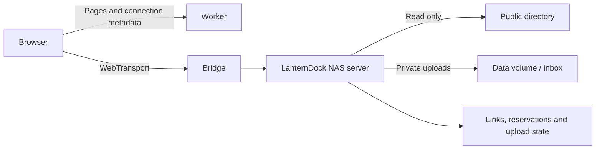

# NAS server and temporary file drops

LanternDock includes an optional Go backend in `server/`. It serves a public folder as **anonymous, read-only WebDAV** and accepts private uploads through **expiring, revocable file-drop links**. Visitors do not need accounts. You can continue using another WebDAV backend for browsing; file-drop links require this NAS service.

The NAS issues the links, enforces quotas and stores upload state in SQLite. The Worker serves the UI, public connection metadata and certificate hashes. File bytes go directly to the NAS over HTTPS or through `webtransport-bridge`; they never pass through the Worker.



## Deploy on a NAS with Docker Compose

Clone the repository onto your NAS. The included [`compose.nas.yaml`](../compose.nas.yaml) builds the NAS service and runs it with the existing bridge image. Set these values in a local `.env` beside the Compose file, preserving other existing settings:

```dotenv
PUBLIC_DIR="/replace/with/the/actual/public/folder"
SITE_ORIGIN="https://nas.example.com"
CERT_WEBHOOK_URL="https://nas.example.com/api/certificates/your-private-derived-token"
```

Use the certificate webhook URL paired with your Worker's `SECRET_KEY`. The NAS upload service does not need the Worker's master key. File-drop tokens are generated independently on the NAS, and only their SHA-256 hashes are stored in SQLite.

```sh
docker compose -f compose.nas.yaml up -d --build
```

The NAS container runs as UID/GID `65532:65532`. Give that user or a suitable group read/search permission on the chosen public folder; use a Compose `user:` override if your NAS requires a particular UID/GID. The `nas-data` volume must remain writable by the chosen user. The public folder is mounted read-only, and the NAS process also rejects WebDAV write methods.

The bridge listens on **4433/udp** (`BRIDGE_PORT` optionally changes the host port). Keep the existing UDP tunnel forwarding to this port. Its backend becomes `http://nas:8080`, allowed paths are `/dav,/api/uploads,/api/account`, and methods are `GET,HEAD,PROPFIND,POST,PUT,DELETE,OPTIONS`. The bridge uses public mode; the NAS service checks every upload's own permission and verifies identity proofs on the account API.

If you keep an existing bridge container instead, attach it and the NAS service to the same Docker network and update those arguments. Preserve the bridge's existing certificate volume, certificate flags and frontend origin. Do not start a second bridge on an occupied host UDP port. Changing to a new bridge certificate volume requires that instance to publish its new hashes before clients connect.

Set these Worker variables while keeping the existing `WEBTRANSPORT_URL`:

```dotenv
BACKEND_ROOT="/dav/"
BACKEND_AUTH="none"
GATEWAY_AUTH="false"
```

The NAS HTTP port is only available on the Compose network. The public WebDAV root is `/dav/`; the whole public folder appears there. Private data and public files must be separate, non-overlapping directories, including when symlinks are resolved. The service refuses to start with overlapping roots. A single NAS server instance owns each data directory; CLI commands can safely operate while it runs.

## Create a file-drop link

Run on the NAS:

```sh
docker compose -f compose.nas.yaml exec nas /lantern-dock link create \
  --data-dir=/data \
  --site=https://nas.example.com \
  --title="Send me your photos" \
  --expires=168h \
  --max-file=1GiB \
  --max-total=10GiB \
  --max-files=100
```

The command prints JSON containing the link ID, limits and shareable `url`. The URL opens a dedicated upload page, for example `https://nas.example.com/#/upload/<random-token>`. The token stays in the URL fragment and is sent to the NAS in an `Authorization: Bearer` header. It is never included in the Worker's configuration or a backend request URL. Treat the link as the upload permission; anyone you give it to can use the same limits.

The actual URL is shown only at creation. `link list` never returns tokens, so save the URL or issue a replacement if you lose it.

Defaults: 24 hours, 1 GiB per file, 10 GiB total and 100 files. Sizes accept bytes or integer `KiB`, `MiB`, `GiB`, `TiB` (decimal `KB`, `MB`, `GB`, `TB` also work). Lifetimes use Go durations such as `24h` or `168h`, up to `8760h`. If you increase the per-file limit beyond 1 GiB, also increase the bridge's `--max-body` and any intervening proxy's body limit.

View quota usage and revoke a link:

```sh
docker compose -f compose.nas.yaml exec nas /lantern-dock link list --data-dir=/data

docker compose -f compose.nas.yaml exec nas /lantern-dock link revoke \
  --data-dir=/data LINK_ID
```

Revocation prevents new requests and finalization immediately. Active uploads are cancelled by the NAS within five seconds. Expiry also cancels active uploads; choose a lifetime that covers the transfer, not just its starting time. Expiry and revocation leave completed files on disk for you to collect.

## Where files go

The private `/data` volume contains:

```text
/data/
  lantern-dock.sqlite        # links, limits and upload state
  lantern-dock.sqlite-wal    # SQLite's live write-ahead log, when present
  server.lock               # single-instance lock
  inbox/
    .staging/               # incomplete files
    <link-id>/
      <upload-id>-<original-name>
```

Uploaded files are **not automatically published**. Collect them from the private data volume and move or copy selected files into your public folder when ready. Separate upload IDs prevent name collisions and overwriting. Do not manually delete quota records from a running database. Moving or deleting a completed file does not restore its link's lifetime quota; create another link for a new collection.

The NAS reserves the declared size and one file slot before transfer, using an SQLite transaction. Reservations count against the shared link quota, including parallel uploads. An unstarted reservation expires after 15 minutes or at link expiry, whichever comes first. Interrupted/cancelled transfers release reservations and remove partial files. The server fsyncs and renames a completed file before committing success, and rechecks the link before finalization. Startup recovers interrupted transfers and removes their partial/orphaned files. There are at most 32 active file bodies per server, with a one-minute read-idle deadline.

Stop the NAS service before making a simple filesystem copy of the data volume, or use SQLite's online backup facilities. Copying only the main `.sqlite` file while it is live can omit committed WAL data. Preserve the whole private volume when updating containers.

## Run without Docker

Requires Go 1.26+ on Linux or macOS:

```sh
cd server
go build -o lantern-dock ./cmd/lantern-dock
./lantern-dock serve --listen=127.0.0.1:8080 \
  --public-dir=/path/to/public --data-dir=/path/to/private-state
```

The binary uses the same `link create`, `link list` and `link revoke` commands. Management is local CLI only in this version: there is no public administrative write API or visitor registration. Optional [OIDC/CIMD login](authentication.md) adds an account page, copyable subjects and NAS-enforced administrator recognition through `ADMIN_SUBJECTS`; it does not change public DAV or collection-link access.

For direct HTTPS connections, place the HTTP server behind your HTTPS reverse proxy and allow your exact frontend origin:

```sh
./lantern-dock serve --public-dir=/path/to/public --data-dir=/path/to/private-state \
  --origins=https://nas.example.com
```

Set `WEBDAV_URL="https://files.example.com/dav/"` on the Worker and clear `WEBTRANSPORT_URL`. The reverse proxy must forward both `/dav/` and `/api/uploads` without changing paths and allow the required body size and transfer duration. Upload progress uses XHR for direct HTTPS and streamed binary writes for WebTransport.

## HTTP interface

All upload endpoints require the file-drop bearer token. A token cannot read file contents or enumerate other uploads. It can inspect a known task belonging to the same drop and cancel an incomplete task. Public WebDAV remains anonymous and read-only.

| Request                    | Result                                                                                    |
| -------------------------- | ----------------------------------------------------------------------------------------- |
| `GET /healthz`             | Service liveness.                                                                         |
| `PROPFIND /dav/`           | Public directory metadata; `Depth: 0` or `1` is required.                                 |
| `GET`, `HEAD /dav/<path>`  | Public files, including Range and conditional reads.                                      |
| `GET /api/uploads`         | This link's title, expiry, limits and aggregate usage; no file listing.                   |
| `POST /api/uploads`        | Reserve a task with JSON `{ "name": "photo.jpg", "size": 12345 }`.                        |
| `PUT /api/uploads/<id>`    | Send exactly the reserved number of binary bytes; returns `201` after durable completion. |
| `GET /api/uploads/<id>`    | Check this task's state, including recovery after a lost response.                        |
| `DELETE /api/uploads/<id>` | Cancel an incomplete task and release quota.                                              |

Errors are JSON with `error` and `code`: `401` for an invalid/missing link token, `410` for an expired/revoked link, `413` for a file above its size limit, `409` for insufficient quota or a conflicting task state, and `503` for storage/service failures. Public WebDAV writes return `405`.

This first version transfers each file in one request. Cancelling or losing an incomplete transfer requires uploading that file again; there is no resumable-upload protocol yet. The UI displays results for the current visit rather than exposing an inbox listing.
